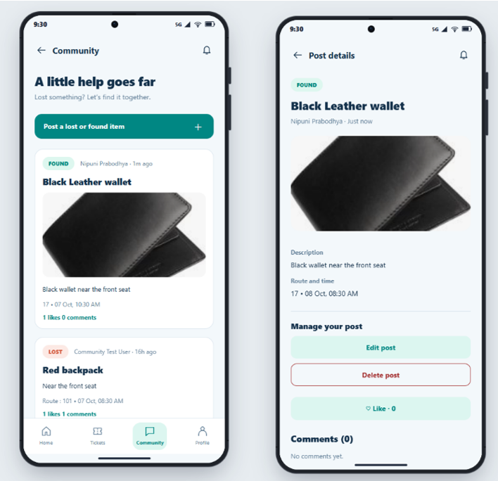
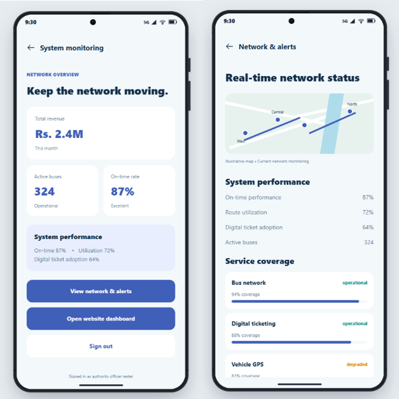
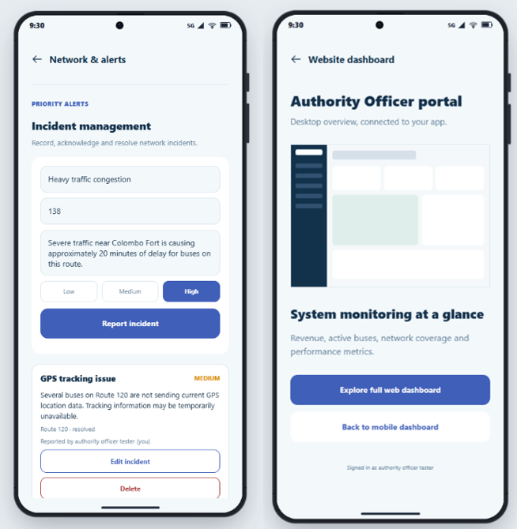
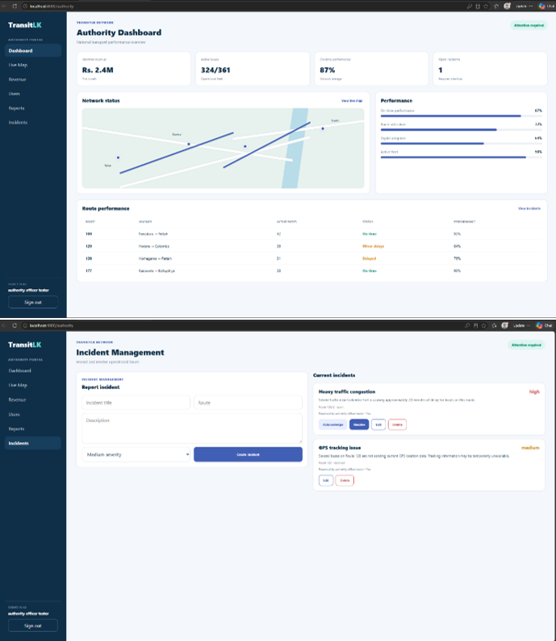

# TransitLK – Public Transport Management Platform

TransitLK is a full-stack public transport management platform developed as a four-member university group project for the **IT3060 Human Computer Interaction** module.

The system combines passenger transport services, ticket-related functionality, live transport information, Lost & Found community features, bus-owner functionality, and Authority Officer monitoring within a single platform.

This repository preserves the original project Git history, including the commits and contributions of all group members.

---

## Key Features

- User registration and authentication
- Passenger profile management
- Journey and route-related functionality
- Live GPS bus tracking
- Ticket verification and conductor functionality
- Payment-related functionality
- Bus-owner management features
- Lost & Found Community
- Authority Officer monitoring
- Operational incident management
- Role-based access control

---

## My Contribution

My primary development responsibilities focused on the **Lost & Found Community** and **Authority Officer Monitoring** modules.

### Lost & Found Community

Implemented a complete Lost & Found workflow that allows passengers to publish and interact with lost or found item posts.

Main functionality includes:

- Lost and Found community feed
- Create, view, edit and delete posts
- Image upload and display
- Likes and comments
- User ownership validation
- REST API integration
- MongoDB persistence
  


### Authority Officer Monitoring

Implemented role-specific functionality for Authority Officers to monitor transport operations and manage incidents.

Main functionality includes:

- Authority Officer authentication
- Mobile monitoring dashboard
- Network and service monitoring
- Incident CRUD operations
- Incident acknowledgement and resolution
- Creator-only edit/delete permissions
- Backend role and ownership validation
- Responsive Authority Officer web portal



---

## Technology Stack

### Mobile Frontend

- React Native
- Expo
- TypeScript
- React

### Backend

- Node.js
- Express.js
- REST APIs
- Zod
- Helmet
- CORS
- Express Rate Limit

### Database

- MongoDB

### Authority Web Portal

- HTML
- CSS
- JavaScript

### Development Tools

- Git
- GitHub
- pnpm
- Visual Studio Code

---

## System Architecture

### Mobile Application Architecture

```text id="dmeauk"
Mobile Application
React Native + Expo + TypeScript
          |
          | HTTP / JSON
          v
Node.js + Express REST API
          |
          | Authentication
          | Authorization
          | Validation
          | Business Logic
          v
       MongoDB
```

The Authority Officer web portal also communicates with the same backend REST API.

### Authority Officer Web Portal Architecture

```text id="zogufa"
Authority Officer Web Portal
HTML + CSS + JavaScript
          |
          v
Node.js + Express API
          |
          v
       MongoDB
```

---

## Security and Validation

The project includes several backend security and validation mechanisms:

- Authentication-protected API endpoints
- Role-based authorization
- Ownership-based permissions
- Backend input validation using Zod
- HTTP security headers using Helmet
- CORS configuration
- Rate limiting for sensitive API routes

For example, an Authority Officer who creates an incident can edit or delete that incident, while other Authority Officers can acknowledge or resolve it without being allowed to modify its ownership-protected details.

---

## Testing

The project was validated using:

- TypeScript type checking
- Backend automated testing
- Backend syntax validation
- Manual CRUD testing
- Authentication and authorization testing
- Interface and usability testing

---

## Screenshots

### Lost & Found Community

The Lost & Found Community allows passengers to view, create, and interact with lost or found item posts.


### Authority Officer Dashboard

The Authority Officer Dashboard provides an overview of transport network and service monitoring information.


### Authority Officer Incident Management

Authority Officers can create, view, acknowledge, resolve, edit, and manage operational incidents according to their assigned permissions.



### Authority Officer Web Portal

The responsive Authority Officer web portal provides access to monitoring, incident management, user information, reports, and other operational features.



---

---

## Project Attribution

TransitLK was developed collaboratively as a four-member university group project.

This personal repository preserves the original Git history and contributor attribution. The historical commits have not been rewritten or reassigned.

My individual implementation work mainly focused on the **Lost & Found Community** and **Authority Officer Monitoring** modules described above.

---

## Original Group Documentation

The original README created during the university group project has been preserved here:

[View Original Group README](https://github.com/NipuniPrabodhya/TransitLK_Mobile_App/blob/main/README_GROUP.md)

---

## Original Group Repository

Original collaborative repository:

[TransitLK_HCI_IT3060](https://github.com/akilatheshan23-lang/TransitLK_HCI_IT3060)
